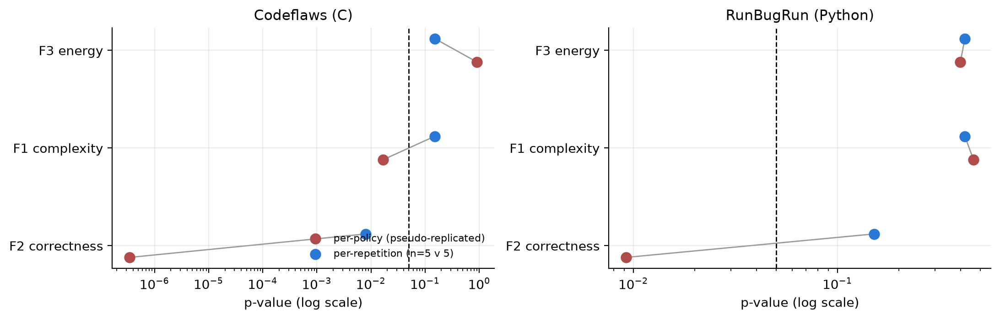
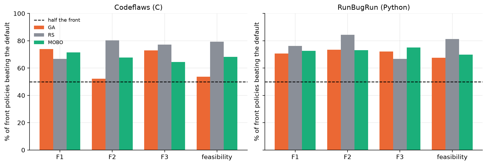
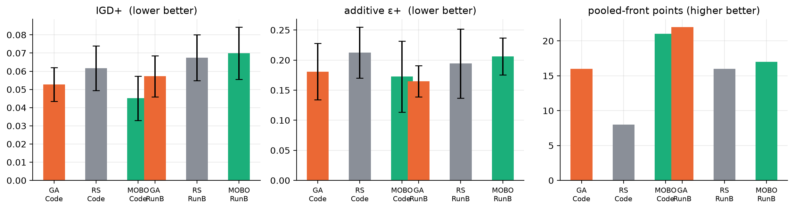
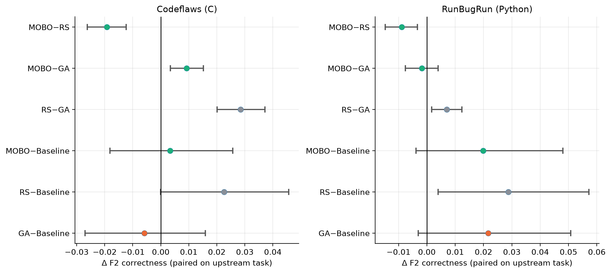
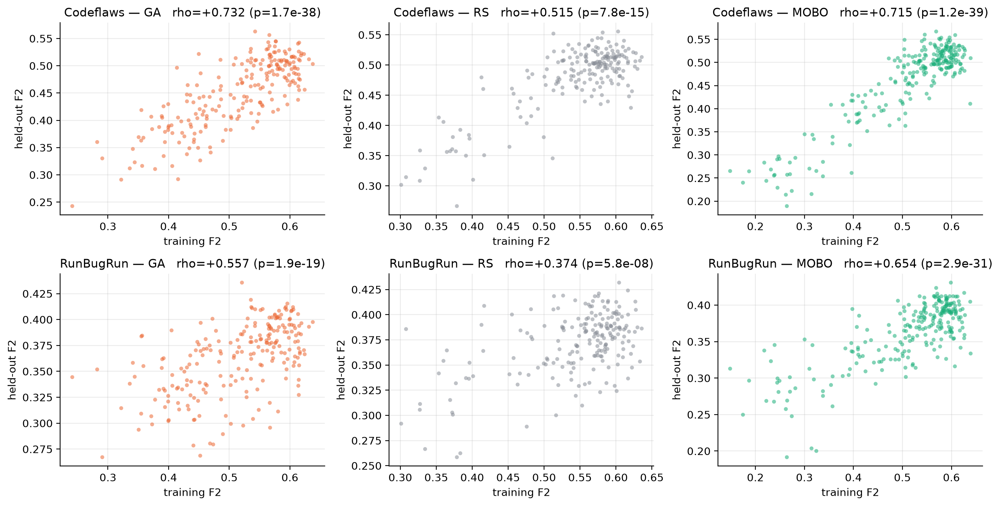
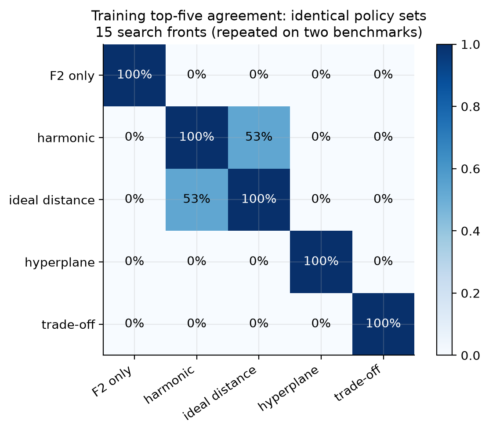
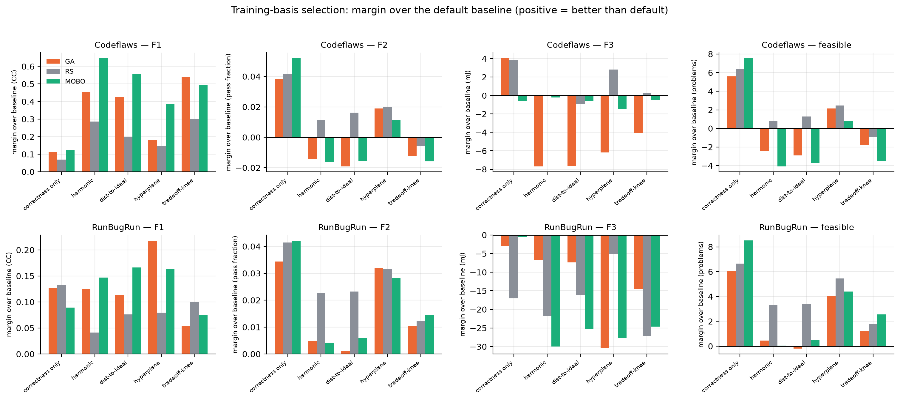
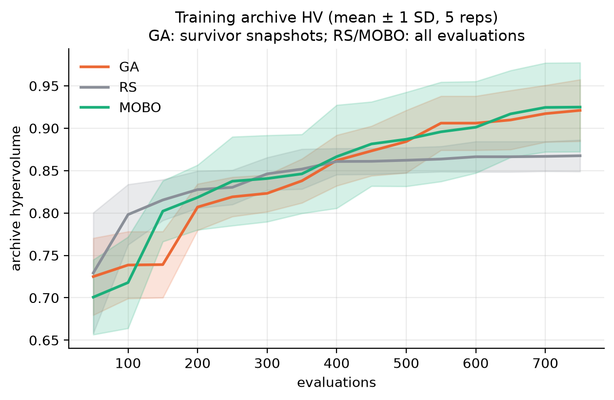

# Replicated Held-Out Comparison of NSGA-II, Random Search and MOBO

> Generated from the executed `three_arm_analysis.ipynb` by
`scripts/generators/export_report.py`. Edit the generator/exporter and rerun the
notebook to update this report. Numeric tables are calculated from all five
repetitions, including MOBO reps 0–4; none is manually transcribed.
The companion [full-precision results](../../analysis/data/three_arm_results.json)
includes per-repetition values, test families and hashes of every data input.

## 1. Scope and status

This report compares three search arms at a matched budget on Codeflaws (C)
and transfers the same retained policies to RunBugRun (Python). All five
repetitions per arm are complete. The default policy has five evaluation
repetitions per benchmark. This revision supersedes earlier three-MOBO-repetition
numbers and the partly updated prose and tables in the previous revision of this report.

The principal result is an exploratory **training-correctness-selected top-five
shortlist** advantage in correctness and feasibility. It does not establish a
universal advantage of optimisation, a single deployable policy, or savings in
total pipeline energy. Detailed results and multiplicity qualifications follow.

## 2. Configuration as executed

| Item | Value |
| --- | --- |
| Model | qwen2.5-coder:1.5b |
| Search space | 11 decoding/retry parameters across Analyzer, Repairer, Verifier and Optimizer |
| GA | NSGA-II, population 50, 15 generations; seeds 42–46 |
| RS | 750 uniform random candidates; seeds 99–103 |
| MOBO | qLogNEHVI; 50 initial random candidates, 700 subsequent candidates; seeds 123–127 |
| Training | The same 50 C bug records for all search repetitions |
| Held-out | 100 records per benchmark; see the task-overlap audit below |
| Evaluation | v3.1 two-phase measurement; real rapl_sysfs; 4 problem workers |
| F1 ↓ | Mean whole-program cyclomatic complexity over feasible records |
| F2 ↑ | Mean test-pass fraction over all records, including zero for infeasible records |
| F3 ↓ | Mean repaired-program execution energy, mJ, over feasible records |
| Feasibility ↑ | Records with correctness > 0, out of 100; not full repair success |

F3 excludes LLM search/repair energy and is conditional on feasibility. Lower F3 with a different feasible subset is not automatically an energy saving for the same work. Means across repetitions use equal repetition weights; pooled-policy summaries weight larger fronts more heavily.

| Arm | rep 0 | rep 1 | rep 2 | rep 3 | rep 4 | Total per benchmark |
| --- | --- | --- | --- | --- | --- | --- |
| GA | 38 | 45 | 50 | 46 | 43 | 222 |
| RS | 34 | 44 | 33 | 42 | 45 | 198 |
| MOBO | 48 | 50 | 59 | 45 | 43 | 245 |

## 3. Provenance and integrity

The notebook asserts five complete repetitions per arm and five baseline repetitions. It checks manifest digests, backend, real measurement and worker count; matches every held-out policy vector and training fitness to the saved search front; verifies all 100 record IDs per evaluation; and recomputes F1, F2, F3 and feasibility from per-record payloads. All checks passed.

| Benchmark | Held-out records | Underlying tasks | Tasks also in excluded training split | Affected held-out records |
| --- | --- | --- | --- | --- |
| C | 100 | 98 | 6 | 7 |
| Python | 100 | 68 | 0 | 0 |

**C is record-disjoint but not task-disjoint.** Its 50 training records cover
49 Codeforces tasks. Six task prefixes occur in both training and held-out data:
`14-B`, `149-B`, `298-B`, `304-A`, `43-B`, `680-B`; they account for seven held-out
records. Stored C `group_id` values were bug-record IDs, so trusting them had
incorrectly implied full task separation. The corrected task bootstrap uses the
prefix before `-bug-`. This changes task-level analyses, not the original
100-record per-policy outcomes or training selections.

Python's 100 records cover 68 upstream tasks, with no overlap with the excluded
50-record/44-task Python reference split. Candidate records were sampled after
group exclusion; tasks were not sampled uniformly. The optimisation training
itself used C. A fresh C split excluding all training tasks is needed for a fully
task-disjoint confirmatory experiment; the post-hoc sensitivity in §10 is not a
replacement for that experiment.

| Benchmark | Held-out SHA-256 |
| --- | --- |
| C | `365503a2457502e94a12ebe7c818b4cd30d335549a7682c7a14dac575b80b6f7` |
| Python | `e3d0637c2d1331fbf0d9116b05fe2192352d9897d0f9d0a46b2b55ca49bb8deb` |

## 4. The unit of replication

Search-strategy inference uses five independent **search repetitions**, not
hundreds of policies from the same trajectories. Primary tests are two-sided
Mann–Whitney U on per-repetition summaries; Welch tests are sensitivity checks.
SciPy uses exact MWU for these small untied samples and an asymptotic tie
correction when tied. The untied minimum is 2/C(10,5) = 0.00794; Holm over four
outcomes can reach 0.03175, and Holm over three can reach 0.02381.

Pooled-policy comparisons are descriptive diagnostics of the evaluated policy
distributions. Their p-values do not establish independent method-level evidence.
The ratios of repetition-level to pooled-policy p-values depend on both the test
and contrast; they are not a universal effective-sample-size correction.

For C F2, GA versus RS has pooled-policy MWU p=3.4665e-07 and repetition-level MWU p=0.00793651, a ratio of approximately 22,895, not the previously stated 160,000. Cliff's δ accompanies the same repetition-level unit as the primary test.

Policy-level versus repetition-level p-values; pooled policies are dependent.

## 5. Held-out aggregates and estimator sensitivity

The following are means ± sample SD of the five per-repetition front means. Baseline rows summarise its five repeats. These marginal centres need not correspond to a real policy: each mean coordinate averages all policies, rather than selecting a coordinate from one policy.

| Benchmark | Arm | F1 ↓ | F2 ↑ | F3 mJ ↓ | Feasible /100 ↑ |
| --- | --- | --- | --- | --- | --- |
| C | Baseline | 9.2595 ± 0.2821 | 0.4580 ± 0.0243 | 35.5597 ± 5.9377 | 68.80 ± 4.44 |
| C | GA | 8.9221 ± 0.1410 | 0.4522 ± 0.0231 | 39.2187 ± 5.6786 | 68.04 ± 3.35 |
| C | RS | 9.0430 ± 0.0230 | 0.4797 ± 0.0041 | 33.1261 ± 2.1650 | 72.05 ± 0.69 |
| C | MOBO | 8.9160 ± 0.1448 | 0.4615 ± 0.0223 | 40.1045 ± 8.5054 | 69.14 ± 3.17 |
| Python | Baseline | 4.6864 ± 0.2004 | 0.3410 ± 0.0154 | 243.5907 ± 11.9418 | 53.40 ± 2.88 |
| Python | GA | 4.5393 ± 0.0243 | 0.3632 ± 0.0092 | 259.1613 ± 5.6887 | 56.64 ± 2.32 |
| Python | RS | 4.5573 ± 0.0373 | 0.3716 ± 0.0063 | 264.9541 ± 11.4767 | 58.21 ± 1.08 |
| Python | MOBO | 4.5727 ± 0.0140 | 0.3625 ± 0.0103 | 255.5164 ± 13.7395 | 57.17 ± 1.26 |

For comparison, the next table pools all retained policies and gives **mean / median**, with larger fronts receiving more weight. These are different estimands from the equally weighted repetition means above. In particular, the updated MOBO C pooled energy mean must not be confused with its mean of five repetition-level means.

| Benchmark | Arm | Pooled F1 mean / median | Pooled F2 mean / median | Pooled F3 mJ mean / median | F3 skew |
| --- | --- | --- | --- | --- | --- |
| C | GA | 8.9144 / 9.0156 | 0.4511 / 0.4641 | 39.4649 / 32.2018 | 8.03 |
| C | RS | 9.0411 / 9.1212 | 0.4798 / 0.4960 | 33.0524 / 32.6775 | 3.53 |
| C | MOBO | 8.9041 / 9.0541 | 0.4601 / 0.4953 | 40.9037 / 33.1434 | 8.69 |
| Python | GA | 4.5378 / 4.5455 | 0.3627 / 0.3688 | 259.0294 / 232.2420 | 1.03 |
| Python | RS | 4.5574 / 4.5583 | 0.3714 / 0.3781 | 264.2917 / 232.6344 | 0.81 |
| Python | MOBO | 4.5729 / 4.5846 | 0.3621 / 0.3707 | 254.6379 / 232.4539 | 1.36 |

### 5.1 Actual policies beating the baseline mean

Shares below pool policies and use strict improvement over the repeated-default mean. Different policies can contribute to different marginal shares; the final column counts policies improving **all three objectives simultaneously**, relative to that baseline mean vector. These are descriptive comparisons without a repeatability guarantee for any one policy.

| Benchmark | Arm | F1 | F2 | F3 | Feasibility | All F1/F2/F3 |
| --- | --- | --- | --- | --- | --- | --- |
| C | GA | 73.9% | 52.3% | 73.0% | 53.6% | 70/222 (31.5%) |
| C | RS | 66.7% | 80.3% | 77.3% | 79.3% | 76/198 (38.4%) |
| C | MOBO | 71.4% | 67.8% | 64.5% | 68.2% | 84/245 (34.3%) |
| Python | GA | 70.7% | 73.4% | 72.1% | 67.6% | 85/222 (38.3%) |
| Python | RS | 76.3% | 84.3% | 66.7% | 81.3% | 92/198 (46.5%) |
| Python | MOBO | 72.7% | 73.1% | 75.1% | 69.8% | 104/245 (42.4%) |

Per-objective shares of retained policies strictly beating the default mean.

### 5.2 Whole-front tests against default

Each repetition is summarised by its front mean or coordinate-wise median and compared with the five default repeats. Holm adjusts four outcomes within each benchmark-arm cell. The table lists every corrected survivor; full results are in the JSON and notebook.

| Estimator | Nominal p < .05 | Holm(4) p < .05 |
| --- | --- | --- |
| mean | 7 | 2 |
| median | 10 | 4 |

| Estimator | Benchmark | Arm | Outcome | Favourable margin | Nominal p | Holm(4) p |
| --- | --- | --- | --- | --- | --- | --- |
| mean | Python | RS | F2 | +0.0306 | 0.0159 | 0.0477 |
| mean | Python | RS | feasibility | +4.8106 | 0.0119 | 0.0477 |
| median | C | RS | F2 | +0.0389 | 0.0079 | 0.0317 |
| median | C | RS | feasibility | +5.5000 | 0.0147 | 0.0441 |
| median | C | MOBO | F2 | +0.0360 | 0.0079 | 0.0317 |
| median | Python | MOBO | F2 | +0.0305 | 0.0079 | 0.0317 |

The previous blanket “no whole-front significance” claim was incorrect.
However, no identical benchmark/arm/outcome survives under **both** mean and
median aggregation. Mean–median disagreements, particularly for C energy,
make a summary-estimator-independent superiority claim unsupported.

## 6. Between-run variance and cross-arm contrasts

SD is across five per-repetition front means; CV = SD / |mean|. In particular, the MOBO energy SD uses all five repetitions. Adaptive search could propagate measurement noise, but these SDs do not isolate that mechanism from other seed and run variation.

| Benchmark | Arm | F2 SD (CV) | F1 SD (CV) | F3 SD (CV) |
| --- | --- | --- | --- | --- |
| C | GA | 0.0231 (5.11%) | 0.1410 (1.58%) | 5.6786 (14.48%) |
| C | RS | 0.0041 (0.86%) | 0.0230 (0.25%) | 2.1650 (6.54%) |
| C | MOBO | 0.0223 (4.83%) | 0.1448 (1.62%) | 8.5054 (21.21%) |
| Python | GA | 0.0092 (2.52%) | 0.0243 (0.54%) | 5.6887 (2.20%) |
| Python | RS | 0.0063 (1.70%) | 0.0373 (0.82%) | 11.4767 (4.33%) |
| Python | MOBO | 0.0103 (2.84%) | 0.0140 (0.31%) | 13.7395 (5.38%) |

Cross-arm MWU p-values below compare per-repetition front means. Holm(3) corrects the three objectives within each benchmark/arm pair. The sign of Δ and δ is Y − X, so positive favours Y only for F2.

| Benchmark | Y − X | Outcome | Δ | Cliff δ | Nominal p | Holm(3) p |
| --- | --- | --- | --- | --- | --- | --- |
| C | RS − GA | correctness | +0.0275 | +1.000 | 0.0079 | 0.0238 |
| C | MOBO − GA | correctness | +0.0093 | +0.360 | 0.4206 | 1.0000 |
| C | MOBO − RS | correctness | -0.0182 | -0.520 | 0.2222 | 0.3016 |
| C | RS − GA | cl | +0.1210 | +0.600 | 0.1508 | 0.3016 |
| C | MOBO − GA | cl | -0.0061 | -0.040 | 1.0000 | 1.0000 |
| C | MOBO − RS | cl | -0.1270 | -0.600 | 0.1508 | 0.3016 |
| C | RS − GA | energy | -6.0927 | -0.600 | 0.1508 | 0.3016 |
| C | MOBO − GA | energy | +0.8858 | -0.200 | 0.6905 | 1.0000 |
| C | MOBO − RS | energy | +6.9785 | +0.760 | 0.0556 | 0.1667 |
| Python | RS − GA | correctness | +0.0084 | +0.600 | 0.1508 | 0.4524 |
| Python | MOBO − GA | correctness | -0.0007 | +0.040 | 1.0000 | 1.0000 |
| Python | MOBO − RS | correctness | -0.0091 | -0.520 | 0.2222 | 0.6667 |
| Python | RS − GA | cl | +0.0180 | +0.360 | 0.4206 | 0.8413 |
| Python | MOBO − GA | cl | +0.0335 | +0.680 | 0.0952 | 0.2857 |
| Python | MOBO − RS | cl | +0.0155 | +0.280 | 0.5476 | 0.6667 |
| Python | RS − GA | energy | +5.7928 | +0.360 | 0.4206 | 0.8413 |
| Python | MOBO − GA | energy | -3.6449 | -0.200 | 0.6905 | 1.0000 |
| Python | MOBO − RS | energy | -9.4377 | -0.520 | 0.2222 | 0.6667 |

Only C F2, RS versus GA, survives this three-outcome correction. There are twelve MOBO-involving objective contrasts across two benchmarks; none rejects at nominal .05. This is not evidence that the arms are equivalent.

## 7. Set-level quality indicators

Objectives are mapped to minimisation (F1, −F2, F3), then normalised using the pooled benchmark-wide ideal and range. Hypervolume retains the original 200,000 uniform Monte Carlo points and seed 20260825, with reference (1.10, 1.10, 1.10). Cached domination masks accelerate the calculation without changing the estimator. Values are estimates; the displayed precision does not remove Monte Carlo error.

| Benchmark | Arm | Raw HV mean ± SD | HV at 33 points mean ± SD | IGD⁺ mean ± SD | ε⁺ mean ± SD | Union contribution |
| --- | --- | --- | --- | --- | --- | --- |
| C | GA | 0.9602 ± 0.0376 | 0.9338 ± 0.0361 | 0.0527 ± 0.0093 | 0.1809 ± 0.0466 | 16/45 |
| C | RS | 0.9255 ± 0.0448 | 0.9124 ± 0.0482 | 0.0617 ± 0.0123 | 0.2125 ± 0.0426 | 8/45 |
| C | MOBO | 1.0052 ± 0.0747 | 0.9731 ± 0.0625 | 0.0451 ± 0.0122 | 0.1726 ± 0.0590 | 21/45 |
| Python | GA | 0.9129 ± 0.0439 | 0.8880 ± 0.0371 | 0.0572 ± 0.0113 | 0.1648 ± 0.0260 | 22/55 |
| Python | RS | 0.8949 ± 0.0679 | 0.8826 ± 0.0780 | 0.0674 ± 0.0127 | 0.1942 ± 0.0575 | 16/55 |
| Python | MOBO | 0.8819 ± 0.0353 | 0.8470 ± 0.0228 | 0.0700 ± 0.0144 | 0.2059 ± 0.0308 | 17/55 |

The size control draws 33 policies without replacement, forty times per front, and averages the resulting HV within each repetition. Its SD is between repetitions, not over all resamples. The union reference for IGD⁺ and ε⁺ is empirical, not the unknown true Pareto front. All three arms contribute non-dominated points.

| Benchmark | Pair | Raw HV nominal p | Controlled HV nominal p |
| --- | --- | --- | --- |
| C | GA–RS | 0.2222 | 0.5476 |
| C | GA–MOBO | 0.4206 | 0.4206 |
| C | RS–MOBO | 0.1508 | 0.1508 |
| Python | GA–RS | 0.4206 | 0.5476 |
| Python | GA–MOBO | 0.3095 | 0.0556 |
| Python | RS–MOBO | 0.8413 | 0.8413 |

No raw or cardinality-controlled HV comparison reaches nominal .05. The mean-HV leading arm stays MOBO on C and GA on Python across reference margins 1.02–1.50 and after cardinality control. A stable leading arm is descriptive, not a statistically established ordering.

Held-out set indicators across all five repetitions of every arm.

## 8. Paired upstream-task inference

The corrected bootstrap resamples 98 C tasks and 68 Python tasks, not 100 independent C records. Observations are first pooled within task across policies/records; each task then has equal weight. F1/F3 use feasible observations only. Larger fronts contribute more observations within a task. Intervals condition on the saved policies and do not capture search-run uncertainty or repair the train/test task overlap. The table shows correctness contrasts; all objective contrasts are exported.

| Benchmark | Contrast | Tasks | Δ F2 | 95% task-bootstrap CI | CI excludes 0 | Wilcoxon nominal p |
| --- | --- | --- | --- | --- | --- | --- |
| C | GA − Baseline | 98 | -0.0058 | [-0.026971, +0.015940] | False | 0.7355 |
| C | RS − Baseline | 98 | +0.0226 | [-0.000043, +0.045666] | False | 0.0232 |
| C | MOBO − Baseline | 98 | +0.0034 | [-0.018076, +0.025675] | False | 0.5651 |
| C | RS − GA | 98 | +0.0285 | [+0.020068, +0.037211] | True | 1.119e-08 |
| C | MOBO − GA | 98 | +0.0092 | [+0.003399, +0.015198] | True | 0.003972 |
| C | MOBO − RS | 98 | -0.0193 | [-0.026217, -0.012382] | True | 7.208e-08 |
| Python | GA − Baseline | 68 | +0.0216 | [-0.003055, +0.050738] | False | 0.5973 |
| Python | RS − Baseline | 68 | +0.0287 | [+0.003975, +0.057219] | True | 0.209 |
| Python | MOBO − Baseline | 68 | +0.0199 | [-0.003876, +0.047992] | False | 0.4981 |
| Python | RS − GA | 68 | +0.0071 | [+0.001746, +0.012402] | True | 0.003831 |
| Python | MOBO − GA | 68 | -0.0018 | [-0.007610, +0.003953] | False | 0.9706 |
| Python | MOBO − RS | 68 | -0.0089 | [-0.014657, -0.003322] | True | 0.005778 |

Paired task-bootstrap correctness differences; C grouping is corrected to 98 tasks.

## 9. Training-to-held-out generalisation

These are correlations among retained policies, pooled over repetitions. Nominal policy-level p-values do not account for within-repetition dependence; they are exploratory. Conditioning on the selected fronts restricts the population, but does not guarantee attenuation or make any coefficient a lower bound.

| Benchmark | Arm | F2 ρ (nominal p) | F1 ρ (nominal p) | F3 ρ (nominal p) |
| --- | --- | --- | --- | --- |
| C | GA | +0.732 (1.68e-38) | +0.278 (2.68e-05) | +0.068 (0.315) |
| C | RS | +0.515 (7.85e-15) | +0.187 (0.00818) | -0.095 (0.182) |
| C | MOBO | +0.715 (1.21e-39) | +0.505 (2.91e-17) | -0.008 (0.9) |
| Python | GA | +0.557 (1.85e-19) | -0.112 (0.0974) | -0.064 (0.346) |
| Python | RS | +0.374 (5.84e-08) | -0.165 (0.0205) | +0.066 (0.357) |
| Python | MOBO | +0.654 (2.9e-31) | +0.034 (0.601) | +0.128 (0.0456) |

Correctness has consistently positive transfer. C complexity also has positive associations, including MOBO; “only correctness transfers” is too strong. MOBO Python energy has a small positive nominal association (about ρ = .128, p = .046), so “all energy p-values exceed .12” was false. It is weak evidence after dependence and multiplicity are considered.

Per-policy training versus held-out correctness, including all five MOBO repetitions.

## 10. Policy selection

### 10.1 Training-selected shortlist versus held-out oracle

Operational shortlists rank policies by recorded training fitness and average the five selected policies' held-out outcomes within each repetition. Harmonic training versus held-out top-five overlap is 0.47/5, versus a combinatorial random expectation of 0.58/5; 18/30 cells have zero overlap. Mean within-front harmonic rank correlation is -0.045, negative in 18/30 cells. The overlap difference from chance is descriptive, not a reported significance test.

| Benchmark | Arm | Selected median held-out harmonic rank | Median front size | Aggregate F2 random-shortlist percentile |
| --- | --- | --- | --- | --- |
| C | GA | 25.0 | 45.0 | 22.80 |
| C | RS | 21.0 | 42.0 | 15.15 |
| C | MOBO | 13.0 | 48.0 | 10.90 |
| Python | GA | 22.0 | 45.0 | 0.55 |
| Python | RS | 25.0 | 42.0 | 10.95 |
| Python | MOBO | 33.0 | 48.0 | 2.15 |

The random reference uses 2,000 independent five-without-replacement shortlists per repetition (seed 20260825), then averages the five repetition means for each draw. Percentiles refer to that aggregate distribution, not to each individual repetition. A low percentile describes this conditional selection reference, not an independently tested search arm.

Harmonic and ideal-distance **training top-five** sets are identical in 16/30 benchmark/arm/repetition cells, with mean overlap 4.467/5. The previously quoted 29/30 agreement applies instead to a **single held-out-oracle policy**, using benchmark-wide normalisation. It does not describe the operational shortlist. The 30 training-selection cells repeat the same 15 search fronts across two benchmarks (8/15 distinct fronts agree). Agreement now compares exact policy vectors, not rounded outcome triples. No agreement count makes the rules preference-free.

Agreement of actual training-selected top-five sets; distinct from held-out oracle agreement.

### 10.2 Correctness-only training selection

The table reports the mean of five per-repetition top-five shortlists. Favourable margins are baseline − selected for F1/F3 and selected − baseline for F2/feasibility. F2 margins are **fractions**: multiply by 100 for percentage points. Relative percentage improvement is a different quantity.

| Benchmark | Arm | Selected F1 | Selected F2 | Selected F3 mJ | Selected feasible /100 | F2 gain (pp) | F2 gain (relative %) |
| --- | --- | --- | --- | --- | --- | --- | --- |
| C | GA | 9.1467 | 0.4965 | 31.5049 | 74.40 | 3.85 | 8.40 |
| C | RS | 9.1898 | 0.4994 | 31.6668 | 75.20 | 4.13 | 9.03 |
| C | MOBO | 9.1354 | 0.5101 | 36.1592 | 76.36 | 5.20 | 11.36 |
| Python | GA | 4.5588 | 0.3754 | 246.4978 | 59.48 | 3.44 | 10.09 |
| Python | RS | 4.5544 | 0.3824 | 260.6417 | 60.04 | 4.14 | 12.14 |
| Python | MOBO | 4.5972 | 0.3832 | 244.1492 | 61.92 | 4.21 | 12.35 |

| Benchmark | Arm | Outcome | Favourable margin | Nominal p | Holm(4) p | Holm(24) p |
| --- | --- | --- | --- | --- | --- | --- |
| C | GA | F1 | +0.1128 | 0.5476 | 0.5476 | 1.0000 |
| C | GA | F2 | +0.0385 | 0.0079 | 0.0317 | 0.1905 |
| C | GA | F3 | +4.0547 | 0.2222 | 0.4444 | 1.0000 |
| C | GA | feasible | +5.6000 | 0.0119 | 0.0358 | 0.2266 |
| C | RS | F1 | +0.0696 | 0.8413 | 0.8413 | 1.0000 |
| C | RS | F2 | +0.0413 | 0.0079 | 0.0317 | 0.1905 |
| C | RS | F3 | +3.8928 | 0.3095 | 0.6190 | 1.0000 |
| C | RS | feasible | +6.4000 | 0.0160 | 0.0479 | 0.2381 |
| C | MOBO | F1 | +0.1241 | 0.5476 | 1.0000 | 1.0000 |
| C | MOBO | F2 | +0.0520 | 0.0079 | 0.0317 | 0.1905 |
| C | MOBO | F3 | -0.5995 | 1.0000 | 1.0000 | 1.0000 |
| C | MOBO | feasible | +7.5600 | 0.0119 | 0.0358 | 0.2266 |
| Python | GA | F1 | +0.1276 | 0.2222 | 0.4444 | 1.0000 |
| Python | GA | F2 | +0.0344 | 0.0159 | 0.0635 | 0.2381 |
| Python | GA | F3 | -2.9071 | 0.8413 | 0.8413 | 1.0000 |
| Python | GA | feasible | +6.0800 | 0.0212 | 0.0635 | 0.2753 |
| Python | RS | F1 | +0.1320 | 0.3095 | 0.4444 | 1.0000 |
| Python | RS | F2 | +0.0414 | 0.0079 | 0.0317 | 0.1905 |
| Python | RS | F3 | -17.0510 | 0.2222 | 0.4444 | 1.0000 |
| Python | RS | feasible | +6.6400 | 0.0119 | 0.0358 | 0.2266 |
| Python | MOBO | F1 | +0.0892 | 0.5476 | 1.0000 | 1.0000 |
| Python | MOBO | F2 | +0.0421 | 0.0079 | 0.0317 | 0.1905 |
| Python | MOBO | F3 | -0.5585 | 0.6905 | 1.0000 | 1.0000 |
| Python | MOBO | feasible | +8.5200 | 0.0119 | 0.0358 | 0.2266 |

There are **20/24 positive margins**, not 24/24; the four negative margins are energy outcomes. 12/24 tests reject nominally and **10/24 survive Holm within each four-outcome benchmark-arm family**, forming five F2/feasibility pairs. Python GA does not survive the within-cell correction. None survives correction over all 24 tests (minimum adjusted p=0.1905). F2 and feasibility are mechanically linked, so these are not ten independent confirmations.

Correctness-only gives the largest mean F2 and feasibility among the five tested rules in all six cells. Its preference was informed by the held-out results; these findings are exploratory. The shortlist mean is not the outcome of a specified deterministic one-policy deployment rule. Complexity advantages of other rules vary by benchmark and arm; energy savings are not established.

| Training rule | Tests | Nominal survivors | Holm(4) survivors | Corrected outcomes |
| --- | --- | --- | --- | --- |
| correctness only | 24 | 12 | 10 | C/GA/F2; C/GA/feasible; C/RS/F2; C/RS/feasible; C/MOBO/F2; C/MOBO/feasible; Python/RS/F2; Python/RS/feasible; Python/MOBO/F2; Python/MOBO/feasible |
| harmonic | 24 | 3 | 1 | C/MOBO/F1 |
| dist-to-ideal | 24 | 3 | 1 | C/MOBO/F1 |
| hyperplane | 24 | 5 | 0 | None |
| tradeoff-knee | 24 | 2 | 1 | C/GA/F1 |

Shortlist margins by selection basis and rule; held-out selection is an oracle diagnostic.

### 10.3 C sensitivity excluding the seven records on training tasks

This post-hoc sensitivity retains the original training-selected policy shortlists and recomputes their outcomes and the repeated baseline on the remaining **93 records from 92 tasks**. It changes the evaluation subset, not policy selection. Feasibility is expressed as a percentage of 93 for comparability; its margin is in percentage points. This diagnostic does not make the original 100-record experiment fully task-disjoint.

| Arm | Outcome | Baseline | Selected | Favourable margin | Nominal p | Holm(4) p |
| --- | --- | --- | --- | --- | --- | --- |
| GA | F1 | 8.6846 | 8.4520 | +0.2326 | 0.2222 | 0.4444 |
| GA | F2 | 0.4553 | 0.4937 | +0.0384 | 0.0317 | 0.1270 |
| GA | F3 | 35.7233 | 32.1030 | +3.6203 | 0.4206 | 0.4444 |
| GA | feasible | 69.0323 | 74.9247 | +5.8925 | 0.0937 | 0.2811 |
| RS | F1 | 8.6846 | 8.4614 | +0.2233 | 0.5476 | 1.0000 |
| RS | F2 | 0.4553 | 0.4948 | +0.0395 | 0.0556 | 0.1667 |
| RS | F3 | 35.7233 | 32.5547 | +3.1685 | 0.6905 | 1.0000 |
| RS | feasible | 69.0323 | 75.5699 | +6.5376 | 0.0317 | 0.1270 |
| MOBO | F1 | 8.6846 | 8.4319 | +0.2527 | 0.3095 | 0.6190 |
| MOBO | F2 | 0.4553 | 0.5090 | +0.0537 | 0.0079 | 0.0317 |
| MOBO | F3 | 35.7233 | 37.0936 | -1.3704 | 0.8413 | 0.8413 |
| MOBO | feasible | 69.0323 | 77.0323 | +8.0000 | 0.0079 | 0.0317 |

All three arms retain positive mean correctness margins on the reduced subset. After within-arm Holm(4), the surviving outcomes are: MOBO/F2, MOBO/feasible. The loss of significance for GA and RS is a sensitivity of this small design; it does not by itself identify how much of the original effect was caused by task overlap.

## 11. Anytime convergence

All curves concern cumulative **training** hypervolume at checkpoints 50, 100, …, 750. RS and MOBO log every candidate; GA logs surviving populations and omits rejected offspring. GA absolute archive HV is a lower bound on all evaluated candidates, but the direction of bias after dividing by its own final HV is unknown. Comparisons involving GA are therefore descriptive archive comparisons.

| Arm | 90% of own final HV | 95% | 99% | Normalised AUC | Last >0.5% gain checkpoint |
| --- | --- | --- | --- | --- | --- |
| GA | 320 ± 186 | 420 ± 135 | 630 ± 125 | 0.9197 ± 0.0343 | 640 ± 134 |
| RS | 100 ± 35 | 170 ± 84 | 430 ± 120 | 0.9728 ± 0.0089 | 450 ± 100 |
| MOBO | 260 ± 108 | 450 ± 141 | 620 ± 76 | 0.9234 ± 0.0209 | 650 ± 87 |

| RS–MOBO outcome | Nominal MWU p | Holm(5) p |
| --- | --- | --- |
| reach_90 | 0.01440 | 0.05759 |
| reach_95 | 0.01962 | 0.05887 |
| reach_99 | 0.03501 | 0.05887 |
| auc | 0.00794 | 0.03968 |
| plateau | 0.02546 | 0.05887 |

RS attains fractions of its own final training HV earlier on average. Of
the five RS–MOBO anytime outcomes, **only normalised AUC survives Holm(5)**.
Threshold times and the plateau have nominal evidence but do not survive that
family correction. These self-final ratios do not compare a common absolute
quality target. Non-significant final held-out differences do not establish
equal quality or equal-outcome cost dominance.

The plateau is the first checkpoint after the last individual gain exceeding
0.5% of final HV. Later smaller gains may accumulate. It is a retrospective
summary, not a validated stopping rule, a direct measure of wasted budget, or a
measured saving in wall time or energy. GA's incomplete archive prevents an
unqualified GA–RS efficiency claim.

Anytime training summaries: GA survivor snapshots; RS and MOBO full evaluation logs.

## 12. Cross-language behaviour and descriptive efficiency

All 665 policy vectors match exactly across benchmarks. Pooled C-versus-Python F2 Spearman ρ = +0.634 (nominal p=3.57e-76). Pooled F2 SD is 0.0703 on C and 0.0368 on Python. These associations condition on retained policies; narrower spread does not make the observed correlation a lower bound.

| Arm | Within-arm cross-language F2 ρ |
| --- | --- |
| GA | 0.629 |
| RS | 0.493 |
| MOBO | 0.706 |

| Benchmark | Arm | Mean of per-policy F2 / execution-energy (J) ratios |
| --- | --- | --- |
| C | GA | 14.792 |
| C | RS | 15.263 |
| C | MOBO | 13.849 |
| C | Baseline | 13.172 |
| Python | GA | 1.440 |
| Python | RS | 1.453 |
| Python | MOBO | 1.462 |
| Python | Baseline | 1.403 |

Each ratio divides a policy’s mean F2 by its mean feasible-record energy in joules; the table averages those ratios across policies. The baseline averages its five repetition-level ratios. This is a mean of ratios, not a ratio of pooled means. The numerator and denominator have different feasibility conditioning. It is not a per-task efficiency estimate at fixed correctness, nor does it include inference/search cost or establish a break-even deployment count.

## 13. Per-task structure

| Benchmark | Tasks | RS > GA | RS < GA | Tied | No passing test in any observation | Every observation fully correct |
| --- | --- | --- | --- | --- | --- | --- |
| C | 98 | 73 | 23 | 2 | 1 | 0 |
| Python | 68 | 41 | 17 | 10 | 8 | 0 |

“No passing test” means F2 = 0 across every observed policy and baseline attempt on that task. “Every observation fully correct” requires F2 = 1 throughout. These are observed extremes, not estimates of an intrinsic achievable repair ceiling. In particular, feasibility is partial test success and must not be described as full repair success.

## 14. Statistical sensitivity and front geometry

The notebook retains repetition-level Cliff’s δ bootstrap intervals, exhaustive permutation tests of mean differences, a normal-model power simulation, exploratory Welch TOST, Shapiro diagnostics, ECDF/QQ plots, Kruskal–Wallis/Dunn tests, front contributions, objective correlations and policy-space PCA. Their roles and limitations differ:

- Bootstrap effect intervals with five observations per arm are uncertain;
  they do not create additional independent repetitions.
- Exact enumeration of label permutations removes Monte Carlo error in that
  permutation test, conditional on exchangeability. It need not equal MWU because
  it tests a different statistic.
- The normal-model power simulation uses 3,000 draws per effect size and nominal
  α=.05. Its approximate detectable effect is model- and variance-dependent;
  it is not empirical power for every benchmark outcome or a corrected family.
- TOST uses an estimated one-baseline-SD margin and uncorrected Welch tests.
  Practical equivalence depends on accepting that margin and those assumptions.
  Non-significant MWU alone is not equivalence.
- Non-rejection of Shapiro with five observations does not validate normality.
- Omnibus and pairwise tests reuse the same data; they are corroborating analyses,
  not independent replications. Rep index does not define a justified cross-arm
  block for a Friedman test.

| Exploratory TOST/MWU classification | Count /18 |
| --- | --- |
| DIFFERENT | 1 |
| EQUIVALENT | 7 |
| inconclusive | 10 |

| Benchmark | Outcome | Kruskal–Wallis H | Nominal p | Mean ranks GA / RS / MOBO |
| --- | --- | --- | --- | --- |
| C | correctness | 6.540 | 0.0380 | 11.4 / 4.2 / 8.4 |
| C | cl | 3.380 | 0.1845 | 6.6 / 11.0 / 6.4 |
| C | energy | 4.380 | 0.1119 | 10.0 / 4.6 / 9.4 |
| Python | correctness | 2.960 | 0.2276 | 9.6 / 5.2 / 9.2 |
| Python | cl | 3.140 | 0.2080 | 5.4 / 8.2 / 10.4 |
| Python | energy | 2.060 | 0.3570 | 7.6 / 10.2 / 6.2 |

| Dunn post-hoc: C mean_correctness | Nominal p | Holm(3) p |
| --- | --- | --- |
| RS-GA | 0.0109 | 0.0327 |
| MOBO-GA | 0.2888 | 0.2888 |
| MOBO-RS | 0.1376 | 0.2751 |

The first two policy-space principal components explain 25.5% of standardised 11-dimensional variance. Overlap in that projection does not establish full-space inseparability or isotropy. F2 and feasibility are mechanically linked; their correlation is not independent evidence for two effects. All arms contribute to the pooled non-dominated sets, so no arm covers every useful region.

## 15. Findings suitable for reporting

1. The completed comparison comprises five repetitions per arm, 222 GA,
   198 RS and 245 MOBO policies, evaluated on each benchmark.
2. Whole-front mean and median tests give some corrected improvements against
   default, but the surviving outcomes are estimator-dependent. A blanket null
   result is incorrect; a universal front-level advantage is also unsupported.
3. Training-correctness top-five shortlists improve mean F2 and feasibility in
   all six cells. Ten outcomes survive four-outcome within-cell Holm correction;
   none survives global correction across 24. The rule was favoured post hoc.
4. MOBO’s five-repetition numbers must replace the older three-repetition
   variance, indicator, correlation and selection entries. No HV comparison is
   significant at nominal .05 after including all repetitions.
5. RS–MOBO normalised training AUC survives correction over five anytime
   summaries. This does not establish equal held-out quality, validated budget
   reductions or end-to-end cost savings.
6. The C split has six overlapping upstream tasks. Report record-level held-out
   performance honestly and use the separate 93-record sensitivity only with its
   changed denominator and post-hoc status stated.

## 16. Threats to validity

Five repetitions, one model, one held-out sample per benchmark and one
language pair limit precision and external validity. Search and evaluation hosts
differ; held-out real RAPL measurements on a common host improve comparability
but do not rule out drift or repair stochasticity. Each retained policy was
measured once, while only default was repeated. Training energy remains part of
training-based selection and the anytime criterion.

Conditional F1/F3 can change when the feasible task composition changes. Front
cardinality affects pooled weighting and HV; the subsampling control is a
sensitivity analysis. Task bootstrap intervals condition on the retained
policies. C task overlap persists in the original results. Choice of selection
rule, shortlist size, multiplicity family and indicator can affect conclusions.
Default decoding is not an expert-tuned comparator. Incomplete GA histories,
self-final normalisation and retrospective plateau definitions limit cost claims.

## 17. Reproduction and figure replacement

Regenerate the notebook from
`scripts/generators/build_three_arm_notebook.py`, then
execute every cell from the repository root.
The final analysis cell regenerates this report and
`analysis/data/three_arm_results.json`. Raw held-out artefacts under `outputs/`
are required in addition to committed training fronts and histories; the JSON
records their input hashes. No experiment is rerun by this analysis.

Figures are written to `analysis/figs/` as `fig_*.png` by the notebook and are
embedded from there.
